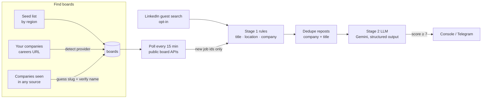

# job-poller

A self-hosted job radar. It watches company job boards for new openings, filters them with your rules, has an LLM
screen each survivor against **your** profile, and alerts you on Telegram - usually minutes after a job is posted.

It never applies to anything. It finds jobs and tells you why they fit (or don't).

```
8/10 · Senior Backend Engineer · Acme · [greenhouse]
Madrid, Spain
✓ Kotlin, Spring Boot, Kafka   ✗ Go nice-to-have   ⚠ -
» Strong match: senior backend role on the JVM, hybrid in Madrid.
https://job-boards.greenhouse.io/acme/jobs/123
```

## How it works



- **Job boards (default source).** Greenhouse (US + EU), Lever (US + EU), Ashby, SmartRecruiters, Personio,
  Teamtailor and Recruitee - their official public APIs, one request per board per poll.
- **Finding boards** - three ways, all feeding one table:
  - a **seed list** shipped in the repo, built from the Common Crawl URL index and tagged by the regions where each
    board had open jobs (`spain`, `europe-remote`; rebuild for any region with `refresh-seed`);
  - **your companies**: give a careers page URL and job-poller finds the job board behind it (many "own" careers
    sites are a skin over one of these providers - e.g. Aircall's page -> Greenhouse board `aircallioinc`, a slug
    nobody would guess);
  - **discovery**: every company seen in any source gets its likely board slugs probed, verified against the
    company name where the API returns one.
- **First poll of a board is a baseline** - existing jobs are remembered, never alerted. Only jobs that appear
  later are processed.
- **Stage 1** is cheap local rules (title include/exclude, accepted locations, remote-in-Europe, blocklist).
- **Stage 2** sends only survivors to Gemini with your profile and criteria and gets back validated JSON
  (`score`, `matched`, `gaps`, `red_flags`, `one_liner`). When the LLM is busy or out of quota, jobs stay pending
  and are scored later - never lost.
- **LinkedIn** guest search is available as an **opt-in** plugin with enforced slow pacing - read
  [docs/linkedin.md](docs/linkedin.md) first.

## Quick start (5 minutes)

Requirements: Docker with Compose, a free [Gemini API key](https://aistudio.google.com/apikey).

```bash
git clone https://github.com/<you>/job-poller.git && cd job-poller
cp .env.example .env                 # add GEMINI_API_KEY (Telegram optional)
cp config.example.yaml config.yaml   # set regions, filters, your profile
docker compose up -d
docker compose logs -f poller
```

On the first run the seed boards for your regions are loaded and polled once as a baseline. From then on, new
matching jobs show up in the logs - and on Telegram if you set it up ([docs/telegram.md](docs/telegram.md)).

### Useful commands

```bash
docker compose run --rm poller python -m jobpoller test-notify          # check your channels
docker compose run --rm poller python -m jobpoller careers https://acme.com/careers "Acme"   # which board?
docker compose run --rm poller python -m jobpoller matches --min 7      # recent matches
docker compose run --rm poller python -m jobpoller stats
docker compose run --rm -v ./seed:/app/seed poller python -m jobpoller refresh-seed    # rebuild the seed list
```

## Configuration

Everything you'd want to change is in `config.yaml` ([config.example.yaml](config.example.yaml) is documented):

| Section | What |
|---|---|
| `regions` | which seed boards to watch (`seed/regions.yaml` defines them; add your own) |
| `companies` | companies you care about: `name` and optionally `careers_url` |
| `boards` | boards you already know, e.g. `greenhouse:stripe`, `lever:acme@eu` |
| `filters` | Stage 1 rules |
| `scorer` | your profile, criteria, alert threshold, Gemini models |
| `linkedin` | opt-in guest search |

Secrets only in `.env`. Data lives in Postgres under `./data/pg` on the host.

## Stack and design notes

- Python 3.12, httpx, selectolax, pydantic, psycopg 3, google-genai; PostgreSQL 16; Docker Compose.
- One process with a small scheduler: board polls, daily discovery, optional LinkedIn cycles, then scoring.
  A failing task is logged and retried at its next slot; it never takes the others down.
- Idempotent by design: job keys are `<source>:<id>`, inserts are `ON CONFLICT DO NOTHING`, notifications are
  recorded per job and per company + title, so reposts don't alert twice.
- Polite by design: honest `User-Agent`, per-provider pacing, `robots.txt` respected on careers pages, stops
  and backs off on HTTP 429.
- Schema migrations are plain numbered SQL files applied at start-up.

More in [docs/architecture.md](docs/architecture.md).

## Development

```bash
docker compose -f docker-compose.test.yml run --rm tests     # pytest against a throwaway Postgres
```

CI (GitHub Actions) runs ruff, pytest with a Postgres service, a Docker build and a gitleaks secret scan.

## Limitations

- Companies with their own career platform (Workday, SuccessFactors, custom sites) are detected but not read yet.
- The seed list is a snapshot from a web archive sample - not every company on each provider.
- Gemini's free tier may use inputs to improve Google's products: only public postings and your profile text are sent.

## License

MIT
